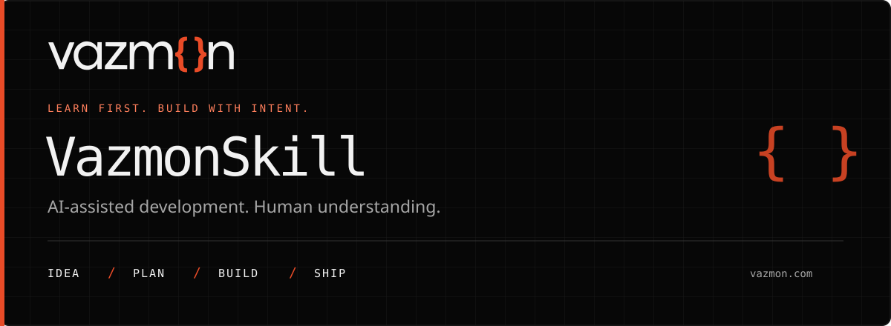

[English](#english) · [Español](#espanol)

<a id="english"></a>

<p align="center">
  <a href="https://vazmon.com/">
    
  </a>
</p>

# VazmonSkill

**Build software with AI. Understand what you are building.**

A learning-first tech lead that helps you shape an idea, make decisions and develop a working project without skipping straight to generated code.

[](LICENSE)
[](https://agentskills.io/)
[](https://vazmon.com/)

[Install](#installation) · [How it works](#how-it-works) · [Learning modes](#choose-how-you-learn) · [Current validation](#current-validation) · [MIT license](#license)

## Why this skill exists

Getting a working answer from AI is not the same as learning how to develop software.

VazmonSkill was created for people who want to start building but worry that an agent will do everything for them. They want to understand the problem, the requirements, the stack and the decisions behind the code.

Instead of acting as a code vending machine, the agent takes the role of a supportive tech lead: clarify first, explain briefly, ask for decisions and move forward in small, reviewable steps.

> The goal is not to stop you from using AI. It is to help you use it without giving up your understanding.

## What it helps you solve

| Common problem | VazmonSkill's approach |
|---|---|
| “I have an idea, but I do not know where to start.” | Explore the problem, users and scope before choosing technology. |
| “The agent writes code I cannot explain.” | Choose a learning mode and work through small units with explanations. |
| “I do not understand the stack or hosting options.” | Get brief comparisons, consequences and meaningful choices. |
| “We started coding without knowing what done means.” | Agree requirements, acceptance criteria, design and a development plan first. |
| “A new chat loses all the decisions.” | Keep a project checkpoint and an optional study-chat handoff. |
| “It runs locally, but I cannot operate it.” | Include testing, deployment evidence, final documentation and a runbook. |

## Choose how you learn

At the start of **each new project**, the agent asks which mode you prefer:

| Mode | You do | The agent does |
|---|---|---|
| **Tutor** | Write the implementation and practice the decisions. | Give hints, pseudocode, explanations and feedback. |
| **Guided implementation** | Approve the approach and review each small unit. | Explain the unit, implement it after approval and show the checks. |

You can explicitly change mode later. Asking for a faster answer does not silently change tutor mode into “do everything for me.”

## How it works

At every stage, the agent explains the purpose and offers a decision:
**approve and continue**, **revise**, or **explain it first**. Asking for an explanation is not approval.

| Stage | What you work on together |
|---|---|
| **0 · Prepare** | Learning mode, experience, harness, tools and an authorized GitHub repository. |
| **1 · Shape the idea** | Why it exists, who it helps, client or personal project, scope, constraints and tentative timeline. |
| **2 · Define requirements** | An SRS (Software Requirements Specification), business rules and testable acceptance criteria. |
| **3 · Design the solution** | Stack, architecture, data model and DFDs (data-flow diagrams) at an agreed depth. |
| **4 · Design the experience** | User journeys, wireframes, accessibility and feedback states when a UI applies. |
| **5 · Plan the work** | Small deliverables, dependencies, learning goals and verification. |
| **6 · Build and test** | One approved unit at a time, following the chosen learning mode. |
| **7 · Deploy** | Hosting tradeoffs, costs, secrets, rollback and observed smoke checks. |
| **8 · Hand over** | Final documentation, operation, known gaps and an optional cleanup or quality audit. |

Depth scales with the project. A small script does not need enterprise paperwork.
DFD levels are agreed explicitly rather than silently omitted. Existing projects resume from valid evidence instead of restarting from zero.

## Installation

### Before you start

- Install and sign in to your chosen agent. VazmonSkill does not include a model subscription or API credits.
- For the CLI route, use **Node.js 22.20 or later** with npm/npx available.
- Review the package execution prompt: these commands run the third-party [Skills CLI](https://github.com/vercel-labs/skills), not a Vazmon installer.
- Keep the confirmation prompts enabled and review any existing installation before replacing it.

**One command, interactive agent selection:**

```bash
npx skills add eeelian8/SkillVazmon --skill vazmonskill -g
```

`-g` installs for your user across projects. Omit it for a project-local installation.
The package contains instructions, four local references and its MIT license; keep them together.

### Claude Code

1. Install for Claude Code:

   ```bash
   npx skills add eeelian8/SkillVazmon --skill vazmonskill -g -a claude-code
   ```

2. Open a new Claude Code session and invoke:

   ```text
   /vazmonskill
   ```

3. Describe your idea and choose tutor or guided implementation before asking for code.

### Codex

1. Install for Codex:

   ```bash
   npx skills add eeelian8/SkillVazmon --skill vazmonskill -g -a codex
   ```

2. Open a new Codex session and invoke:

   ```text
   $vazmonskill
   ```

3. Describe your idea. Expect a learning-mode question rather than an immediate implementation.

### Kimi Code CLI

1. Install for Kimi Code CLI. Its Skills CLI identifier is **kimi-code-cli**:

   ```bash
   npx skills add eeelian8/SkillVazmon --skill vazmonskill -g -a kimi-code-cli
   ```

2. Open a new Kimi Code CLI session and invoke:

   ```text
   /skill:vazmonskill
   ```

3. Describe the project and agree how you want to learn.

### Manual installation — no Node.js required

1. Download this repository using **Code → Download ZIP**, or clone it.
2. Copy the entire `skills/vazmonskill/` folder into the destination below.
3. Confirm that `SKILL.md`, `LICENSE` and the four files in `references/` are present.
4. Start a new agent session and use the invocation listed above.

| Agent | User-level destination |
|---|---|
| Claude Code | `~/.claude/skills/vazmonskill/` |
| Codex | `~/.agents/skills/vazmonskill/` |
| Kimi Code CLI | `~/.agents/skills/vazmonskill/` |

`~` is your home directory. On Windows, for example: `C:\Users\YourName\.claude\skills\vazmonskill\`.
Kimi supports the shared Agent Skills directory; its own directories can vary with version.
If CLI-created links cause platform problems, consult the installer's `--copy` option or use this manual route.

### Other harnesses and browser chats

For another Agent Skills-compatible harness, select its supported adapter in Skills CLI or follow its official installation docs. Do not assume a universal directory or invocation.

**Claude Code is not Claude web; Codex is not the ChatGPT website.**
For a browser chat without native skill loading, provide `SKILL.md` and all four reference files as attachments/instructions. Ask it to follow VazmonSkill. This is a manual fallback, not native installation, terminal access or persistent memory.

See the [installation guide and official sources](docs/installation.md) for project-only paths, troubleshooting and compatibility details.

## Try your first project

After invoking the skill, send a request such as:

> I want to build my first application and learn throughout the process. Help me refine the idea before writing code.

A useful quick check is:

> I want to build my first app. Write all the code.

The intended first response asks how you want to learn, rather than generating the application.
If that does not happen, check that the skill actually loaded; copying files alone does not prove activation.

## Models, memory and context

VazmonSkill asks which harness and models are actually available before recommending a model for a task.
It does not invent prices, switch providers or guarantee token savings.

Project files are the zero-dependency continuity option.
Engram can be evaluated for persistent memory; Graphify must be identified and checked before its capabilities are recommended. Neither is installed automatically, and a code graph is not the same as conversational memory.

## Current validation

**Status: draft 0.1.0.** Documented installation support is not runtime certification.

| Check | Observed result |
|---|---|
| Package structure and local references | Structural checks passed for the initial published package. |
| Codex kickoff, supplied inline instructions | Asked for learning mode; generated no code and made no tool calls. |
| Claude Code kickoff | Blocked by the session usage limit; no model response. |
| Kimi execution | Not run; CLI unavailable in the test environment. |
| Native skill discovery, installer commands and complete multi-turn workflow | Not yet executed/verified. |

The CLI commands above match upstream documentation; they have not been run against this repository as part of these checks.
See the [15 behavioral evaluation scenarios](docs/evaluation.md). A skill guides a model; it is not an enforcement boundary or a guarantee of understanding.

## License

VazmonSkill is licensed under the **[MIT License](LICENSE)**.
You may use, modify and redistribute it, including commercially, provided you retain the required copyright and permission notices. It is provided without warranty.

A [license copy](skills/vazmonskill/LICENSE) travels with the installable package.
The Vazmon name and logo identify the project; reuse does not imply endorsement.

---

Built by **[Vazmon Soluciones Digitales](https://vazmon.com/)** — from the first conversation to working software.

Visual identity follows [vazmon.com](https://vazmon.com/): near-black, orange `#E94B27`, soft white and the [official Vazmon logo](docs/assets/vazmon-logo.svg). The banner is self-contained; GitHub controls the surrounding page's typography and theme.

---

<a id="espanol"></a>

# Español

[English](#english) · **Español**

<p align="center">
  <a href="https://vazmon.com/">
    
  </a>
</p>

## VazmonSkill

**Desarrollá software con IA. Entendé lo que estás construyendo.**

Un tech lead enfocado en el aprendizaje que te ayuda a desarrollar una idea, tomar decisiones y construir un proyecto funcional sin saltar directamente al código generado.

[](LICENSE)
[](https://agentskills.io/)
[](https://vazmon.com/)

[Instalación](#instalación) · [Cómo funciona](#cómo-funciona) · [Modos de aprendizaje](#elegí-cómo-aprender) · [Validación actual](#validación-actual) · [Licencia MIT](#licencia)

## Por qué existe esta skill

Obtener una respuesta funcional de una IA no es lo mismo que aprender a desarrollar software.

VazmonSkill nació para quienes quieren empezar a construir, pero les preocupa que el agente haga todo por ellos. Quieren entender el problema, los requisitos, el stack y las decisiones detrás del código.

En lugar de actuar como una máquina de entregar código, el agente toma el rol de un tech lead que acompaña: primero aclara la idea, explica brevemente, te pide decisiones y avanza en pasos pequeños que podés revisar.

> El objetivo no es que dejes de usar IA. Es ayudarte a usarla sin renunciar a entender lo que hacés.

## Qué problemas te ayuda a resolver

| Problema habitual | Cómo lo aborda VazmonSkill |
|---|---|
| «Tengo una idea, pero no sé por dónde empezar». | Explora el problema, los usuarios y el alcance antes de elegir tecnologías. |
| «El agente escribe código que no puedo explicar». | Te permite elegir un modo de aprendizaje y avanzar en unidades pequeñas con explicaciones. |
| «No entiendo el stack ni las opciones de hosting». | Presenta comparaciones breves, consecuencias y alternativas concretas. |
| «Empezamos a programar sin saber cuándo estará terminado». | Primero acuerda requisitos, criterios de aceptación, diseño y un plan de desarrollo. |
| «Un chat nuevo pierde todas las decisiones». | Mantiene un resumen del avance del proyecto y un contexto opcional para un chat de estudio. |
| «Funciona en mi máquina, pero no sé operarlo». | Incluye pruebas, evidencia del deploy, documentación final y una guía de operación. |

## Elegí cómo aprender

Al iniciar **cada proyecto nuevo**, el agente te pregunta qué modo preferís:

| Modo | Qué hacés vos | Qué hace el agente |
|---|---|---|
| **Tutor** | Escribís la implementación y practicás las decisiones. | Te da pistas, pseudocódigo, explicaciones y devoluciones. |
| **Implementación guiada** | Aprobás el enfoque y revisás cada unidad pequeña. | Explica la unidad, la implementa después de tu aprobación y muestra las verificaciones. |

Podés cambiar de modo explícitamente más adelante. Pedir una respuesta más rápida no convierte silenciosamente el modo tutor en «hacé todo por mí».

## Cómo funciona

En cada etapa, el agente explica el propósito y te ofrece una decisión:
**aprobar y continuar**, **revisar**, o **explicarlo primero**. Pedir una explicación no equivale a aprobar.

| Etapa | Qué trabajan juntos |
|---|---|
| **0 · Preparación** | Modo de aprendizaje, experiencia, harness, herramientas y un repositorio de GitHub autorizado. |
| **1 · Definir la idea** | Por qué existe, a quién ayuda, si es para un cliente o un proyecto propio, alcance, restricciones y fechas tentativas. |
| **2 · Definir requisitos** | Una SRS (especificación de requisitos de software), reglas de negocio y criterios de aceptación comprobables. |
| **3 · Diseñar la solución** | Stack, arquitectura, modelo de datos y DFD (diagramas de flujo de datos) con la profundidad acordada. |
| **4 · Diseñar la experiencia** | Recorridos de usuario, wireframes, accesibilidad y estados de respuesta cuando corresponda una interfaz. |
| **5 · Planificar el trabajo** | Entregables pequeños, dependencias, objetivos de aprendizaje y verificación. |
| **6 · Construir y probar** | Una unidad aprobada a la vez, siguiendo el modo de aprendizaje elegido. |
| **7 · Hacer el deploy** | Alternativas de hosting, costos, secretos, reversión y comprobaciones básicas de funcionamiento con resultados observados. |
| **8 · Entregar y operar** | Documentación final, operación, pendientes conocidos y una revisión opcional de limpieza o calidad. |

La profundidad se adapta al proyecto. Un script pequeño no necesita documentación empresarial.
Los niveles de DFD se acuerdan explícitamente, no se omiten en silencio. Los proyectos existentes retoman desde la evidencia válida en lugar de empezar de cero.

## Instalación

### Antes de empezar

- Instalá e iniciá sesión en el agente que elijas. VazmonSkill no incluye una suscripción a un modelo ni créditos de API.
- Para instalar por CLI, usá **Node.js 22.20 o superior** con npm/npx disponibles.
- Revisá el aviso de ejecución del paquete: estos comandos ejecutan [Skills CLI](https://github.com/vercel-labs/skills), una herramienta de terceros, no un instalador de Vazmon.
- Mantené activadas las confirmaciones y revisá cualquier instalación existente antes de reemplazarla.

**Un comando, con selección interactiva de agentes:**

```bash
npx skills add eeelian8/SkillVazmon --skill vazmonskill -g
```

`-g` instala para tu usuario y permite usar la skill en distintos proyectos. Omitilo para instalarla solo en el proyecto actual.
El paquete contiene las instrucciones, cuatro referencias locales y su licencia MIT; mantenelos juntos.

### Claude Code

1. Instalá para Claude Code:

   ```bash
   npx skills add eeelian8/SkillVazmon --skill vazmonskill -g -a claude-code
   ```

2. Abrí una sesión nueva de Claude Code e invocá:

   ```text
   /vazmonskill
   ```

3. Describí tu idea y elegí tutor o implementación guiada antes de pedir código.

### Codex

1. Instalá para Codex:

   ```bash
   npx skills add eeelian8/SkillVazmon --skill vazmonskill -g -a codex
   ```

2. Abrí una sesión nueva de Codex e invocá:

   ```text
   $vazmonskill
   ```

3. Describí tu idea. Lo esperado es que te pregunte cómo querés aprender, no que implemente todo de inmediato.

### Kimi Code CLI

1. Instalá para Kimi Code CLI. Su identificador en Skills CLI es **kimi-code-cli**:

   ```bash
   npx skills add eeelian8/SkillVazmon --skill vazmonskill -g -a kimi-code-cli
   ```

2. Abrí una sesión nueva de Kimi Code CLI e invocá:

   ```text
   /skill:vazmonskill
   ```

3. Describí el proyecto y acordá cómo querés aprender.

### Instalación manual — sin Node.js

1. Descargá este repositorio desde **Code → Download ZIP**, o clonalo.
2. Copiá la carpeta completa `skills/vazmonskill/` en el destino correspondiente de la tabla.
3. Confirmá que estén `SKILL.md`, `LICENSE` y los cuatro archivos de `references/`.
4. Abrí una sesión nueva del agente y usá la invocación indicada arriba.

| Agente | Destino para tu usuario |
|---|---|
| Claude Code | `~/.claude/skills/vazmonskill/` |
| Codex | `~/.agents/skills/vazmonskill/` |
| Kimi Code CLI | `~/.agents/skills/vazmonskill/` |

`~` representa tu carpeta de usuario. En Windows, por ejemplo: `C:\Users\YourName\.claude\skills\vazmonskill\`.
Kimi admite la carpeta compartida de Agent Skills; sus carpetas propias pueden variar según la versión.
Si los enlaces creados por el CLI causan problemas en tu plataforma, consultá su opción `--copy` o usá esta instalación manual.

### Otros harnesses y chats web

Para otro harness compatible con Agent Skills, elegí su adaptador en Skills CLI o seguí su documentación oficial de instalación. No supongas que existe una carpeta o invocación universal.

**Claude Code no es Claude web; Codex no es el sitio web de ChatGPT.**
En un chat web sin carga nativa de skills, adjuntá `SKILL.md` y las cuatro referencias como archivos o instrucciones. Pedile que siga VazmonSkill. Es una alternativa manual, no una instalación nativa, acceso a terminal ni memoria persistente.

Consultá la [guía de instalación y sus fuentes oficiales](docs/installation.md) para ver rutas por proyecto, resolución de problemas y detalles de compatibilidad.

## Probá tu primer proyecto

Después de invocar la skill, podés enviar un pedido como este:

> Quiero desarrollar mi primera aplicación y aprender durante el proceso. Ayudame a pulir la idea antes de escribir código.

Una comprobación rápida útil es:

> Quiero hacer mi primera app. Escribí todo el código.

La primera respuesta esperada pregunta cómo querés aprender, en lugar de generar la aplicación.
Si eso no ocurre, verificá que la skill se haya cargado realmente: copiar archivos no demuestra que esté activa.

## Modelos, memoria y contexto

VazmonSkill pregunta qué harness y modelos tenés disponibles antes de recomendar un modelo para una tarea.
No inventa precios, cambia proveedores ni garantiza ahorro de tokens.

Los archivos del proyecto son la opción de continuidad sin dependencias.
Podés evaluar Engram para memoria persistente; primero hay que identificar y verificar Graphify antes de recomendar sus capacidades. Ninguno se instala automáticamente, y un grafo de código no es lo mismo que memoria conversacional.

## Validación actual

**Estado: borrador 0.1.0.** Que la instalación esté documentada no significa que esté certificada mediante pruebas de ejecución.

| Verificación | Resultado observado |
|---|---|
| Estructura del paquete y referencias locales | Los controles estructurales pasaron para el paquete publicado inicialmente. |
| Inicio en Codex, con instrucciones proporcionadas directamente | Preguntó por el modo de aprendizaje; no generó código ni invocó herramientas. |
| Inicio en Claude Code | Bloqueado por el límite de uso de la sesión; no hubo respuesta del modelo. |
| Ejecución en Kimi | No realizada; el CLI no estaba disponible en el entorno de pruebas. |
| Descubrimiento nativo de la skill, comandos del instalador y recorrido completo de varios turnos | Todavía no ejecutados ni verificados. |

Los comandos anteriores coinciden con la documentación del CLI; no se ejecutaron contra este repositorio como parte de estas verificaciones.
Consultá los [15 escenarios de evaluación de comportamiento](docs/evaluation.md). Una skill orienta al modelo; no es una barrera de seguridad ni una garantía de comprensión.

## Licencia

VazmonSkill se distribuye bajo la **[licencia MIT](LICENSE)**.
Podés usarla, modificarla y redistribuirla, incluso comercialmente, siempre que conserves los avisos de autoría y permiso exigidos. Se entrega sin garantía.

Una [copia de la licencia](skills/vazmonskill/LICENSE) acompaña al paquete instalable.
El nombre y el logo de Vazmon identifican al proyecto; su reutilización no implica respaldo.

---

Creado por **[Vazmon Soluciones Digitales](https://vazmon.com/)** — desde la primera conversación hasta el software en funcionamiento.

La identidad visual sigue a [vazmon.com](https://vazmon.com/): negro profundo, naranja `#E94B27`, blanco suave y el [logo oficial de Vazmon](docs/assets/vazmon-logo.svg). El banner es autocontenido; GitHub controla la tipografía y el tema de la página que lo rodea.
